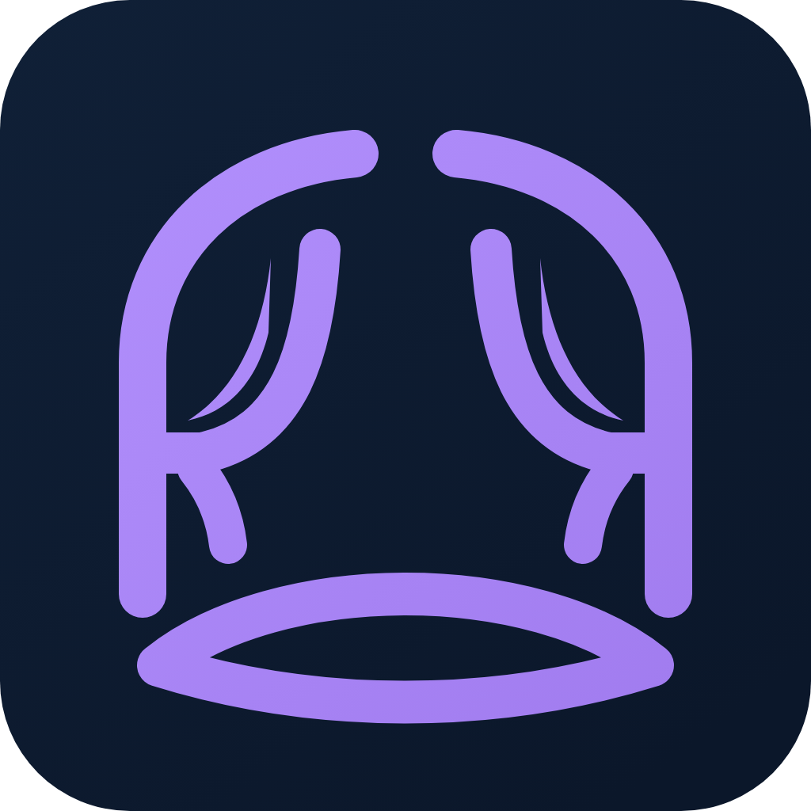

# OpenStage Author

[Roadmap & Feature Requests](https://app.productbridge.io/widget/784db895-cb64-45f4-9bde-4645df4aa083?tab=roadmap)

A free, open-source desktop authoring studio for interactive eLearning.

**Your course. Your file. No subscription, no quota, nothing phoning home.**

OpenStage Author is a freeform, slide-based authoring tool. You place objects on a canvas, give them states and
triggers, narrate them, and publish a SCORM package that runs in your LMS.

It is built for higher education, where the people making courses often pay for their
tools out of pocket.

## Status

[OpenStage Author 1.0.0](https://github.com/jasonswrench-beep/openstage-author/releases/tag/v1.0.0) is the first full release, for Windows:
a signed installer with the editor, the player and what publishing needs. Download `OpenStage-Author-1.0.0-Setup.exe` from that page
and check it against the SHA-256 given there.

Keep copies of what you make with it, and try a published course in your own LMS before students see it.

## Why this exists

OpenStage Author gives course authors a freeform canvas with a timeline, object states, variables and triggers.

## Two things that make it different

**The authoring tool is itself accessible.** The W3C's Authoring Tool Accessibility
Guidelines separate two requirements: that a tool helps you produce accessible content,
and that the tool is usable by an author with a disability.

A blind instructional designer should be able to do this job. ATAG Part A conformance is
a design constraint here from the first commit, not an audit before release.

**You own the file.** The project format is open, documented and plain text. A published
package can carry the editable source too: tick "Include an editable copy of the course"
when you publish, and anyone with the package can open and change it in OpenStage Author.
It is off unless you choose it. Nothing expires, because there is nothing to expire.
Anyone can write a converter.

Plain text also means version history, diffs and rollback work through tools that
already exist.

## Running costs

None. Narration and captions are generated by local models on your own machine, so
there is no per-user cost to recover and no credits to meter. Nothing you author is sent
anywhere.

## Shared pieces and what counts as installed

The OpenStage and Prism apps follow one rule for finding things on the computer:

- **Shared pieces live in one fixed folder each, directly under `%ProgramData%`** (found with Windows' known-folder call, not from the environment): the GPU Voice Pack in `%ProgramData%\GPU Voice Pack`, and voice models (speech recognition, voice detection, speaker models and voices) in `%ProgramData%\Voice Models`. Every app and both hubs (OpenStage Hub and Prism Hub) look for them there and nowhere else. A piece counts as installed only when its files are there and its folder can be changed only by the account that installed it, SYSTEM and the Administrators.
- **Apps are found where they are installed**: in Windows' installed apps list, or in the app's own per-user folder (`%LOCALAPPDATA%\<app name>`). Never on `PATH`.
- **Runtimes ship inside the app's own installer** (Node.js, Python, a speech engine). Nothing has to be installed separately, and an installed app never falls back to a copy it finds on `PATH`.

OpenStage Author downloads its Whisper speech models into `%ProgramData%\Voice Models\speech`, so the other apps can use them too. Models it downloaded before, into its own data folder (`%LOCALAPPDATA%\com.openstageauthor.editor\speech-models`), are still found there, and it keeps using that folder when the shared one cannot be used safely (made first by another account, or changeable by one). The narration engine (Kokoro) is not a shared piece: it is Python code and a PyTorch model, which runs code when it is loaded, so it stays in the editor's own folder for this person alone. Its Python and Node.js ship inside its installer.

## Licence

Apache License 2.0. See [LICENSE](LICENSE).

Third-party components keep their own licences. [Kokoro-82M](https://huggingface.co/hexgrad/Kokoro-82M),
used for narration, is Apache 2.0.

Spoken narration also needs a speech engine, which the editor can install on your computer when
you press a button in its Narration dialog (it asks first). Parts of that engine are under the GNU
General Public License (for example phonemizer-fork and espeak-ng). OpenStage Author does not
include, bundle, or host them: they are downloaded from their own publishers onto your computer.

## Contributing

Not yet, but soon. If you are an instructional designer rather than a developer, the
most useful thing you can offer right now is a description of what your current tool
makes you do by hand.
