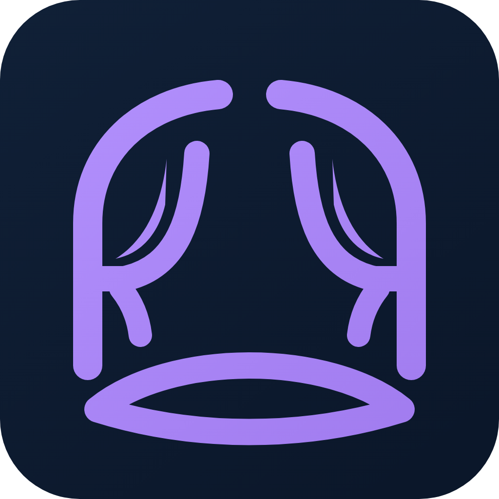

# OpenStage Author

A free, open-source desktop authoring studio for interactive eLearning.

**Your course. Your file. No subscription, no quota, nothing phoning home.**

OpenStage Author is a freeform, slide-based authoring tool in the same lane as an eLearning authoring suite
the eLearning authoring platform and an eLearning authoring platform. You place objects on a canvas, give them states and
triggers, narrate them, and publish a SCORM package that runs in your LMS.

It is built for higher education, where the people making courses often pay for their
tools out of pocket.

## Status

Early. There is no editor yet. The project is building the file format, a validator, and
the player first, on the principle that the published course has to be right before the
thing that authors it is worth building.

Nothing here is usable for real coursework yet.

## Why this exists

Every free authoring tool available today is template-driven: pick a component, fill in
fields, preview separately. an interactive content framework, Adapt, an open authoring toolkit and eXeLearning all work this way. It is a
good model and they do it well.

Nobody has built a free freeform canvas, with a timeline, object states, variables and
triggers. That is the gap OpenStage Author is for.

## Two things that make it different

**The authoring tool is itself accessible.** The W3C's Authoring Tool Accessibility
Guidelines separate two requirements: that a tool helps you produce accessible content,
and that the tool is usable by an author with a disability. The industry delivers the
first and not the second. an eLearning authoring suite's own documentation states that the the eLearning authoring platform 360
authoring experience is only partially accessible, and their staff have said publicly
that they have no timeline for changing that.

A blind instructional designer should be able to do this job. ATAG Part A conformance is
a design constraint here from the first commit, not an audit before release.

**You own the file.** The project format is open, documented and plain text. The
published package contains the editable source by default. Nothing expires, because
there is nothing to expire. Anyone can write a converter, including a competitor.

Plain text also means version history, diffs and rollback work through tools that
already exist.

## Running costs

None. Narration and captions are generated by local models on your own machine, so
there is no per-user cost to recover and no credits to meter. Nothing you author is sent
anywhere.

## Licence

Apache License 2.0. See [LICENSE](LICENSE).

Third-party components keep their own licences. [Kokoro-82M](https://huggingface.co/hexgrad/Kokoro-82M),
used for narration, is Apache 2.0.

Spoken narration also needs a speech engine, which the editor can install on your computer when
you press a button in its Narration dialog (it asks first). Parts of that engine are under the GNU
General Public License (for example phonemizer-fork and espeak-ng). OpenStage Author does not
include, bundle, or host them: they are downloaded from their own publishers onto your computer.

## Contributing

Not yet, but soon. If you are an instructional designer rather than a developer, the
most useful thing you can offer right now is a description of what your current tool
makes you do by hand.
